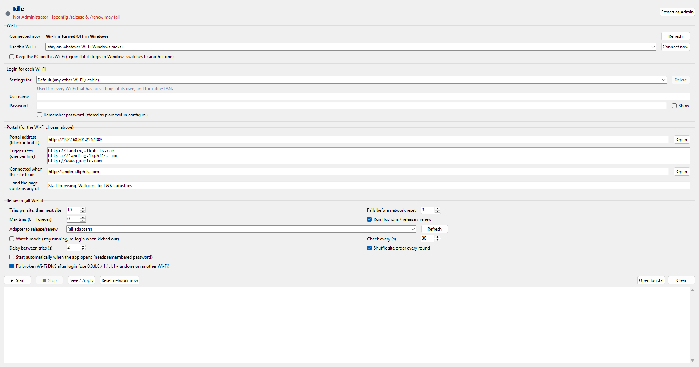

# Wi-Fi Auto Login (FortiGate)

Our office Wi-Fi (L&K-Office and L&K-Guest) sits behind a FortiGate login page, and it kicks you out every so often. Logging back in by hand gets old fast, especially when the guest Wi-Fi decides DNS doesn't work until you're logged in. So I made this little tool that does it for me.

You put in your username and password once, press Start, and it keeps you online.



## Download

Grab `WiFiAutoLogin.exe` from the [Releases](../../releases) page. No install needed and no Python needed, just put it in a folder and run it.

Windows will ask for admin rights when it opens. That's on purpose: `ipconfig /release` and `/renew` don't work without it. You can say no and it will still log in, it just can't reset the network when things get stuck.

The first time it runs it creates a `config.ini` and a `logs` folder next to the exe.

## How to use it

1. Open the app.
2. Type your username and password. Tick "Remember password" if you don't want to type it every time (heads up: it's saved as plain text in `config.ini`).
3. Press **Start**.

That's it for most people. If you want it to stay running in the background and log you in again whenever you get kicked out, tick **Watch mode** before pressing Start.

### Different settings per Wi-Fi

L&K-Office and L&K-Guest don't behave the same, so you can give each Wi-Fi its own settings. Pick the Wi-Fi in "Settings for", change what's different, then press **Save / Apply**. The app checks which Wi-Fi you're on and uses the right settings automatically. Any Wi-Fi without its own settings (or a cable connection) uses Default.

If you leave the portal address blank, the app finds it on its own and fills it in.

### Other options

- **Keep the PC on this Wi-Fi**: if Windows hops over to another network, the app switches back.
- **Run flushdns / release / renew**: after a few failed tries it resets the network, same as you'd do by hand.
- **Fix broken Wi-Fi DNS**: on the guest Wi-Fi the DNS sometimes never works, even after logging in. With this on, the app points the Wi-Fi adapter to 8.8.8.8 and 1.1.1.1. It switches back to normal when you join a different Wi-Fi.
- **Start automatically when the app opens**: handy if you put the exe in your Startup folder.

## What it actually does

Basically it repeats the steps you'd do in a browser:

1. Opens a normal http site (google, neverssl, our landing page...) so the FortiGate redirects to its login page.
2. If nothing opens because DNS is dead, it goes to the portal by IP address instead (`http://1.1.1.1`, the gateway on port 1003, etc).
3. Fills in the login form and submits it.
4. Checks that `landing.lkphils.com` (or the internet in general) really loads.
5. If it still isn't working after a few tries, it does flushdns / release / renew and starts over.

Everything it does goes into `logs/wifi_login_YYYY-MM-DD.txt`. The log never contains your password. Logs older than 30 days get deleted.

## Running from source

If you'd rather run the Python version:

```
pip install requests
python wifi_login_gui.py
```

Or double-click `run_wifi_login.bat`, which asks for admin rights first.

There's also a command-line version with no window:

```
python wifi_login.py            # log in once and exit
python wifi_login.py --watch    # keep running
```

Settings go in `config.ini`. Copy `config.example.ini` to `config.ini` to start, or just let the app make one.

## Building the exe

```
pip install pyinstaller requests
python -m PyInstaller --noconfirm WiFiAutoLogin.spec
```

The exe ends up in `dist/`. Set `WIFI_NO_UAC=1` before building if you want a version that doesn't ask for admin.

## Things to know

- Only tested on English Windows 10/11. It reads the output of `netsh`, which is in a different language on other Windows versions.
- If you don't pick an adapter, release/renew resets all of them, including your cable connection.
- Your password is stored in plain text if you tick Remember. Don't share your `config.ini`.
